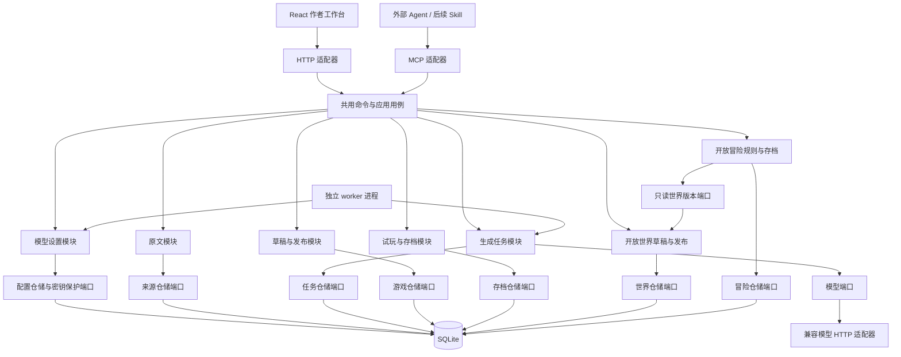

# 低耦合模块边界

模块之间的业务协作由组合根注入结构化端口。生成器只能读取来源、调用模型、提交经过游戏服务校验的草稿。试玩只能读取固定发布版本；不能修改作者草稿。应用服务没有 Express Request/Response、MCP Context 或数据库连接。

一个模块内，纯校验与状态转换在 domain；流程和仓储端口在 application；SQLite 实现在 infrastructure。每个模块只有 index.ts 对外导出，协议 DTO 位于 contracts。改变数据库、Agent 或模型调用方式时，尽量只替换适配器。

共用命令表不是业务大服务，只完成输入结构校验和用例分发。模块不通过全局事件总线隐式调用，worker 与 API 不共享内存状态。增加功能先定义它负责的数据和公开操作，避免生成万能 service/repository/utils。

## 状态边界

| 数据 | 所属模块 | 修改规则 |
|---|---|---|
| 原始文件、章节、段落 | sources | 导入后固定；重新导入生成新来源 |
| 分析断点、租约、错误、结果ID | generation | 持有有效租约的 worker 可提交 |
| 草稿 | games | 通过 version 乐观并发更新 |
| 发布游戏 | games | 不可变；同一草稿版本发布幂等 |
| 已发生剧情、当前回合、动作结果 | sessions | 单个 SQLite 事务写入；请求幂等 |
| 世界草稿、来源与规则校验 | worlds | version 乐观锁；证据限定选择章节 |
| 发布世界 | worlds | 不可变；相同草稿版本发布幂等 |
| 事实、玩家/NPC 知识、位置、时间与事件 | adventure-sessions | 纯规则转换；状态与动作结果同事务；固定世界版本 |
| 模型地址、名称、超时、加密凭据 | model-settings | revision 乐观锁；查询不返回密钥 |

应用首次运行由各模块仓储建立自己的表。连接由 platform 的 `node:sqlite` 适配提供，同步事务保留立即写锁与失败回滚；模块仓储负责 SQL，领域/应用层禁止导入 `node:sqlite`。从原 SQLite 扩展切换到 Node 标准库不改变数据库表、固定发布版本或 JSON 记录。未来变更已发布数据结构需要显式的有版本迁移，不直接依赖 `CREATE TABLE IF NOT EXISTS` 修改旧表。本阶段没有自动破坏性迁移。

分支故事的变量规则由 sessions 领域纯函数判断，选项投影和行动执行共用条件逻辑。数值、字符串和布尔变量在发布时检查引用与类型；行动效果与存档、幂等响应一同提交。新字段均可省略，旧发布内容保持不变，旧存档缺少变量状态时按空集合处理，不补写后来草稿或发布版本的初值。条件图仍需试玩验证，静态连通性不等于状态可达性。

网页使用统一中文/英文词典与 React Context，持久化的 locale 仅属于界面层。原文、草稿、模型输出及领域规则不依赖语言选择；切换界面语言不销毁编辑状态，也不翻译作者内容。

模型设置模块通过 SecretCodec 端口处理凭据；本地文件及加密算法在 platform，SQLite 在模块 infrastructure。API 与 worker 分别打开同一数据库，worker 每次执行读取一次完整配置快照，运行中的任务不混用新旧配置。网页和 MCP 仅调用共用命令，不能直接读写密钥文件。环境模型配置仅作首次保存前的回退值；不引入配置全局缓存或进程间消息依赖。API 请求和 worker 失败写入按组件/日期分割的 JSONL 日志，日志只记录请求 ID、状态、耗时、任务标识与错误码，不记录凭据或正文。

## 扩展顺序

现有开放运行时已支持有限建议行动。下一步优先完善小说资料到世界规则的改编质量，以及条件/效果的可视化编辑。自由文本以后由行动解释适配器转成受限行动提议，游戏规则仍控制状态提交，不让 LLM 直接改数据库。RPG 数值规则独立模块，不能堆进 HTTP/MCP 路由。冒险转小说读取已有存档经历，不反向改写已发生的状态。

## 演进章程（低耦合 / 高延伸）

产品可能演进为「传统文字类型游戏 + AI」的完善开放类型游戏编辑器。五层分离、PR 检查清单、反模式与当前耦合风险见 **[extensibility.md](./extensibility.md)**。摘要：

- **Substrate**（图 / variables / 条件效果 / 世界书 / 规则引擎）慢变、无题材 if、domain 不碰 LLM
- **Catalog**（数值模板等）只编译下行到 Substrate
- **AI adapters** 可替换；只建议/映射，状态只经 sessions·adventures·games 端口提交
- **Authoring UI** 只读 contracts，不发明并行状态语义
- **Transport** 仅 HTTP/MCP 共用命令表

相关：[`stat-templates.md`](./stat-templates.md)、[`if-editor-patterns.md`](./if-editor-patterns.md)。

## 开放世界的规则边界

`worlds` 负责创作数据及来源校验，`adventure-sessions` 负责运行状态；彼此通过公开入口和只读发布端口协作。generation 通过草稿写入端口按 mode 分流；任务完成与草稿写入由组合根放进同一事务，模型调用不占用事务。传输层只做 DTO 校验与服务分发。

开放运行时进一步拆为条件判断、效果应用、事件结算、行动推进、系统行动和玩家投影等纯函数。事实与知识明确分离：隐藏事实可存在于世界真值中，未 reveal 不出现在玩家已知列表；NPC 知识仅作条件判定，不暴露给试玩 DTO。首版知识是事实 ID 集合而非带时间的信念模型，不支持误信/遗忘。

一次性事件按作者数组顺序扫描，触发的效果可激活其他事件，每个事件每存档至多执行一次。行动后先结算事件，再匹配条件结局，最后判断超时；查看页面不推进时间。保留的系统等待行动确保没有其他可执行行动时仍可推进事件或超时。运行时不调用模型、不执行生成脚本。

结构/证据校验不能判断公开叙述是否剧透，也不证明所有条件组合可达。静态地点描述应只描述稳定环境，变化写入行动/事件文本；作者需在发布前审阅并通过多路线试玩检查规则与文字一致性。
