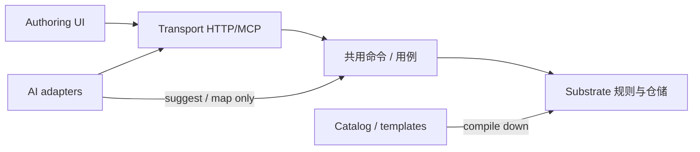

# 演进章程：低耦合与高延伸性

> 产品方向：演进为「传统文字类型游戏编辑器 + AI」的完善开放类型游戏编辑器。  
> **所有构建必须保证低耦合与高延伸性。**  
> 本文是对 [`architecture.md`](./architecture.md) 模块边界的**演进约束**补充；日常 PR 以本文清单自检。

相关文档：[`stat-templates.md`](./stat-templates.md)（数值模板编目）· [`if-editor-patterns.md`](./if-editor-patterns.md)（传统 IF 用法映射）。

---

## 1. 产品定位（锁定）

本书工坊不是「一次性小说改编脚本」，而是可长期生长的：

1. **传统文字游戏作者面**（图 / 数值 / 条件效果 / 世界书 / 试玩）
2. **可替换的 AI 适配层**（骨架、延申、旁白、提案、补全文）
3. **同一套硬状态基底**上的开放玩法（选项型故事 + 开放冒险）

延伸时优先加**数据编目与适配器**，不优先加题材专属运行时。

---

## 2. 五层分离（必须可独立替换）

| 层 | 职责 | 可变速度 | 硬禁止 |
|---|---|---|---|
| **1. Substrate（基底）** | 图节点/边、`variables` + conditions/effects、世界书约束、sessions / adventure-sessions 规则引擎 | 慢 | 题材 `if/else`；domain 导入 LLM / React / Express / SQL |
| **2. Catalog / templates（编目）** | 数值模板、未来题材包、可玩性启发式配置 | 中 | 自建并行状态机；输出必须**编译下行**到 Substrate |
| **3. AI adapters（可替换）** | generate / narrate / propose-act / fill-text / 天道 prompt | 快 | 直接写 SQLite / 绕过规则端口提交状态；换模型商要动 domain |
| **4. Authoring UI（呈现）** | 画布、StatEditor、选项规则、玩时 HUD | 中 | 发明 contracts 没有的 effect/condition 语义；本地一套「真状态」 |
| **5. Transport** | HTTP / MCP **同一命令表** | 中 | 在适配器里复制游戏规则 |

模块内部分层仍遵 `architecture.md`：`domain`（纯）→ `application`（端口）→ `infrastructure`（SQLite 等）；对外只经模块 `index.ts`。

---

## 3. 每张 PR 的延伸检查清单

- [ ] **新题材** → 新模板 / 编目数据（或 prompt 种子），**不是**新 runtime 模块  
- [ ] **新 AI 能力** → 新 adapter / use-case，挂在既有 port 后；状态写入只经 sessions / adventures / games 端口  
- [ ] **新 effect / condition 种类** → 先改 `packages/contracts`，再同步 **story 与 open** 两边运行时，并写迁移策略；禁止只改 UI  
- [ ] **端口优先**：新协作面落在 `modules/*/domain` + `application`；禁止 domain 导入 `platform/model` 或 React  
- [ ] **版本戳**：内容带 `statTemplateId`（及同类戳记）；破坏性变更 **bump version**，禁止静默改名已发布变量  
- [ ] **跨模块**只 import 对方 `index.ts`；禁止深入 `domain/` / `infrastructure/`  
- [ ] **故事图画布**不绑死开放世界 schema；共享的是 contracts 与命令表，不是互相深耦合组件树  

架构门禁脚本：`scripts/check-architecture.ts` / `architecture-rules.ts`（模块边、核心层禁依赖）。新增规则时优先补脚本，而不是只写文档。

---

## 4. 反模式（显式禁止）

| 反模式 | 为何致命 |
|---|---|
| `if (templateId === 'xianxia')` 写进 session / adventure runner | 题材分叉引擎，后期无法共用世界书与存档 |
| LLM 直接写 SQLite 行 / 绕过规则引擎改 variables/facts | 状态真相撕裂；试玩与发布不可审计 |
| Web 与 Server 各写一套条件/效果语义 | UI 显示「可选」但服务端拒绝（或相反） |
| God service / 万能 repository / utils 大杂烩 | 边界消失，无法单独替换 AI 或存储 |
| 跨模块越过 `index.ts` 深引用 | 重构成本指数上升 |
| 故事图编辑器强耦合开放世界冒险 schema | 两条产品线互相拖垮；应经 contracts / 命令表协作 |
| UI-only 新 effect 种类 | 发布与试玩不一致；存档无法回放 |

---

## 5. 与现有能力的对应

| 已有 | 落在哪一层 |
|---|---|
| `variables` / story conditions·effects / worldbook | Substrate |
| `STAT_TEMPLATES`、`statTemplateId`+`version` | Catalog |
| generation provider、narrate、propose-act、fill-scene-text、天道 prompt | AI adapters |
| 无限画布、StatEditor、ChoiceRulesEditor、PlayStatsBar | Authoring UI |
| `apps/server` HTTP + MCP 共用 commands | Transport |
| sessions 纯规则推进；adventure-sessions 纯规则推进 | Substrate（两套内容模型，**同一纪律**：AI 不提交状态） |

故事运行时与开放冒险运行时**刻意分模块**（`sessions` vs `adventure-sessions`），共享纪律与 contracts 形状，不强制合并成一个 God runner——这是延伸性，不是重复浪费。

---

## 6. 当前风险（轻量审计 · 2026-10-27）

扫描范围：`apps/server/src/modules/**/domain`、`apps/web/src`、`packages/contracts`、generation 对 session 的写入面。  
本轮**不做大重构**；仅记录风险，并对安全的一处重复实现做了最小清理。

| 风险 | 位置 | 严重度 | 处置 |
|---|---|---|---|
| Web 曾本地复制 `choiceAvailable`，与 contracts `reachability.choiceAvailable` 双份语义 | `apps/web/src/lib/play-overlay.ts` | 中 | **已修**：改为 `reachChoiceAvailable` 再导出，权威在 contracts |
| `sessions/domain/story-variables.choiceAvailable` 与 contracts 逻辑同形；`applyChoiceEffects` 另含世界书 cap/spend | `story-variables.ts` vs `packages/contracts/src/reachability.ts` | 中 | **暂留**：服务端版本挂 worldbook，不能无脑替换；后续应抽「纯条件」共用、效果路径保留模块扩展点 |
| 内置 Demo 本地实现 `canChoose` / 应用 effects（略宽于权威：缺 `Object.hasOwn`） | `apps/web/src/components/DemoPreview.tsx` | 低 | 文档记录；Demo 离线示意，真试玩走 API；有空再切到 contracts |
| `moveTarget(effects)` 在 web 两处同形 | `world-play-overlay.ts`、`world-graph.ts` | 低 | 仅展示拓扑，不提交状态；可抽小 helper，非本轮 |
| edge-summary / ChoiceRulesEditor 按 type 分支展示文案 | web 展示层 | 可接受 | 种类闭集来自 contracts；新增种类必须先改 schema |
| generation infrastructure 持有 SqliteDatabase | `generation/infrastructure/sqlite-job-repository.ts` | 可接受 | 在 infrastructure，非 domain；只管任务表 |
| domain 导入 LLM / React / Express | 扫描无命中 | — | 保持；由 architecture 脚本守卫 |
| `if (statTemplateId === 'xianxia…')` 进 runner | 扫描无命中（仅目录/测试引用 id） | — | 保持禁止 |
| generation 直接 mutate sessions / adventures | 扫描无命中（经草稿写入端口 / 组合根） | — | 保持 |
| 跨模块深引用越过 index | architecture 脚本 + 抽查无新增违规 | — | 保持门禁 |

**未做（刻意）**：合并 story 与 adventure 规则引擎；把 worldbook-aware effects 强行塞进 contracts；自定义用户模板库；大挪移 DemoPreview。

---

## 7. 延伸路线图（纪律，非排期承诺）

1. **Catalog 加厚**：题材包 = 模板 + 提示种子 + 可选可玩性权重；仍 compile-down。  
2. **条件/效果种类扩展**：contracts → 双运行时 → 迁移文档 → UI；一次一种。  
3. **AI 新能力**：一律「建议 / 映射 / 填文」，提交仍走 act 端口。  
4. **作者面**：StatEditor / 画布 / HUD 只消费 contracts；不复制权威求值。  
5. **开放世界与分支故事**：共享命令与设计纪律；schema 分治，避免编辑器强绑。

---

## 8. 一句话纪律

> **状态真相在 Substrate；题材与提示在 Catalog；智能在 Adapter；编辑器只编辑与展示；传输只转发命令。**  
> 任何让 AI、UI 或题材 id 直接改写运行时分支的补丁，都视为架构回归。
