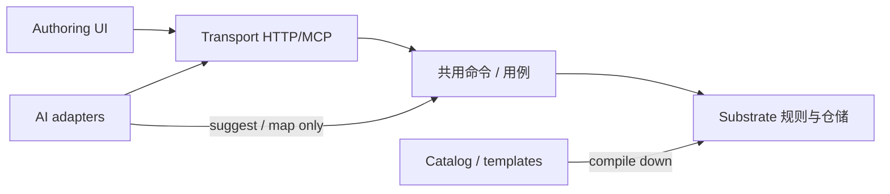

# 演进章程：低耦合与高延伸性

> 产品方向：演进为「传统文字类型游戏编辑器 + AI」的完善开放类型游戏编辑器。  
> **所有构建必须保证低耦合与高延伸性。**  
> 本文是对 [`architecture.md`](./architecture.md) 模块边界的**演进约束**补充；日常 PR 以本文清单自检。

相关文档：[`stat-templates.md`](./stat-templates.md)（数值模板编目）· [`if-editor-patterns.md`](./if-editor-patterns.md)（传统 IF 用法映射）· [`world-map-editor.md`](./world-map-editor.md)（世界地图/地形/势力层设计）。

---

## 1. 产品定位（锁定）

本书工坊不是「一次性小说改编脚本」，而是可长期生长的：

1. **传统文字游戏作者面**（图 / 数值 / 条件效果 / 世界书 / 试玩）
2. **可替换的 AI 适配层**（骨架、延申、旁白、提案、补全文）
3. **同一套硬状态基底**上的开放玩法（选项型故事 + 开放冒险）

延伸时优先加**数据编目与适配器**，不优先加题材专属运行时。

---

## 2. 五层分离（必须可独立替换）

| 层 | 职责 | 可变速度 | 硬禁止 |
|---|---|---|---|
| **1. Substrate（基底）** | 图节点/边、`variables` + conditions/effects、世界书约束、sessions / adventure-sessions 规则引擎 | 慢 | 题材 `if/else`；domain 导入 LLM / React / Express / SQL |
| **2. Catalog / templates（编目）** | 数值模板、未来题材包、可玩性启发式配置 | 中 | 自建并行状态机；输出必须**编译下行**到 Substrate |
| **3. AI adapters（可替换）** | generate / narrate / propose-act / fill-text / 天道 prompt | 快 | 直接写 SQLite / 绕过规则端口提交状态；换模型商要动 domain |
| **4. Authoring UI（呈现）** | 画布、StatEditor、选项规则、玩时 HUD | 中 | 发明 contracts/rules 没有的 effect/condition 语义；本地一套「真状态」 |
| **5. Transport** | HTTP / MCP **同一命令表** | 中 | 在适配器里复制游戏规则 |

模块内部分层仍遵 `architecture.md`：`domain`（纯）→ `application`（端口）→ `infrastructure`（SQLite 等）；对外只经模块 `index.ts`。

---

## 3. 每张 PR 的延伸检查清单

- [ ] **新题材** → 新模板 / 编目数据（或 prompt 种子），**不是**新 runtime 模块  
- [ ] **新 AI 能力** → 新 adapter / use-case，挂在既有 port 后；状态写入只经 sessions / adventures / games 端口  
- [ ] **新 effect / condition 种类** → schema/DTO 先改 `packages/contracts`，纯求值进 `packages/rules`，再同步 **story 与 open** 两边运行时包装，并写迁移策略；禁止只改 UI  
- [ ] **端口优先**：新协作面落在 `modules/*/domain` + `application`；禁止 domain 导入 `platform/model` 或 React  
- [ ] **版本戳**：内容带 `statTemplateId`（及同类戳记）；破坏性变更 **bump version**，禁止静默改名已发布变量  
- [ ] **跨模块**只 import 对方 `index.ts`；禁止深入 `domain/` / `infrastructure/`  
- [ ] **故事图画布**不绑死开放世界 schema；共享的是 contracts 与命令表，不是互相深耦合组件树  

架构门禁脚本：`scripts/check-architecture.ts` / `architecture-rules.ts`（模块边、核心层禁依赖）。新增规则时优先补脚本，而不是只写文档。

---

## 4. 反模式（显式禁止）

| 反模式 | 为何致命 |
|---|---|
| `if (templateId === 'xianxia')` 写进 session / adventure runner | 题材分叉引擎，后期无法共用世界书与存档 |
| LLM 直接写 SQLite 行 / 绕过规则引擎改 variables/facts | 状态真相撕裂；试玩与发布不可审计 |
| Web 与 Server 各写一套条件/效果语义 | UI 显示「可选」但服务端拒绝（或相反） |
| God service / 万能 repository / utils 大杂烩 | 边界消失，无法单独替换 AI 或存储 |
| 跨模块越过 `index.ts` 深引用 | 重构成本指数上升 |
| 故事图编辑器强耦合开放世界冒险 schema | 两条产品线互相拖垮；应经 contracts / 命令表协作 |
| UI-only 新 effect 种类 | 发布与试玩不一致；存档无法回放 |

---

## 5. 与现有能力的对应

| 已有 | 落在哪一层 |
|---|---|
| `variables` / story conditions·effects / worldbook | Substrate |
| `STAT_TEMPLATES`、`statTemplateId`+`version` | Catalog |
| generation provider、narrate、propose-act、fill-scene-text、天道 prompt | AI adapters |
| 无限画布、StatEditor、ChoiceRulesEditor、PlayStatsBar | Authoring UI |
| `apps/server` HTTP + MCP 共用 commands | Transport |
| sessions 纯规则推进；adventure-sessions 纯规则推进 | Substrate（两套内容模型，**同一纪律**：AI 不提交状态） |

故事运行时与开放冒险运行时**刻意分模块**（`sessions` vs `adventure-sessions`），共享纪律与 contracts 形状，不强制合并成一个 God runner——这是延伸性，不是重复浪费。

---

## 6. 当前风险（轻量审计 · 2026-10-27）

扫描范围：`apps/server/src/modules/**/domain`、`apps/web/src`、`packages/contracts`、`packages/rules`、generation 对 session 的写入面。  
本轮**不做大重构**；仅记录风险，并对安全的一处重复实现做了最小清理。

| 风险 | 位置 | 严重度 | 处置 |
|---|---|---|---|
| Web 曾本地复制 `choiceAvailable`，与 reachability 双份语义 | `apps/web/src/lib/play-overlay.ts` | 中 | **已修**：改为 `@novel-game/rules` 的 `reachChoiceAvailable` 再导出 |
| `sessions` / `adventure-sessions` 纯条件·效果曾与引擎双份 | `story-variables.ts` · `rules.ts` | 中 | **已修**：纯匹配/纯效果权威在 `@novel-game/rules`；sessions 只包 worldbook cap/spend；adventures `matches` 委托 `matchesWorldConditions` |
| 内置 Demo 曾本地实现 `canChoose` / effects（略宽于权威） | `apps/web/src/components/DemoPreview.tsx` | 低 | **已修**：改用 `@novel-game/rules` `reachChoiceAvailable` / `reachApplyEffects` |
| `moveTarget(effects)` 曾在 web 两处同形 | `world-play-overlay.ts`、`world-graph.ts` | 低 | **已修**：抽到 `apps/web/src/lib/world-move.ts` |
| edge-summary / ChoiceRulesEditor 按 type 分支展示文案 | web 展示层 | 可接受 | 种类闭集来自 contracts；新增种类必须先改 schema |
| generation infrastructure 持有 SqliteDatabase | `generation/infrastructure/sqlite-job-repository.ts` | 可接受 | 在 infrastructure，非 domain；只管任务表 |
| domain 导入 LLM / React / Express | 扫描无命中 | — | 保持；由 architecture 脚本守卫 |
| `if (statTemplateId === 'xianxia…')` 进 runner | 扫描无命中（仅目录/测试引用 id） | — | 保持禁止 |
| generation 直接 mutate sessions / adventures | 扫描无命中（经草稿写入端口 / 组合根） | — | 保持 |
| 跨模块深引用越过 index | architecture 脚本 + 抽查无新增违规 | — | 保持门禁 |

**未做（刻意）**：合并 story 与 adventure 规则引擎；自定义用户模板库；旁白 visitCache 抽成跨进程 port（仍为单进程软缓存）；世界效果纯 apply 迁入 rules；磁盘插件加载 / 运行时用户自定义种类。

---

## 6.1 架构优化落地（2026-10-27 · 续）

按审核 Top 3 已落地：

1. **纯条件/效果权威**：`packages/rules`（`choiceAvailable` / `applyChoiceEffects` / `matchesWorldConditions` / worldbook runtime）；sessions 只包 worldbook cap/spend 包装；adventures `matches` 委托 rules。schema 仍在 contracts。
2. **模块公开面 + 门禁**：`sessions` / `adventure-sessions` index 导出 narrate·propose；`app/`·`adapters/` 禁止深引用模块内部（architecture-rules）；`Workbench.createPlayProvider()` 收拢 ChatCompletions 构造。
3. **作者 UI 缝**：`useStoryCanvasPlay` / `useWorldCanvasPlay` + `StoryPlayInspector` / `WorldPlayInspector` 拆出画布试玩与 AI 辅助，DraftPanel/WorldsPanel 保留作者壳。
4. **P2 低风险去重（续）**：DemoPreview 对齐 rules；`moveTarget` 抽到 `world-move.ts`；AI 适配器落点 + visitCache 软缓存纪律写入本文。
5. **contracts / rules 分包**：纯求值引擎迁入 `packages/rules`；contracts 只留 schema/DTO/编目。
6. **KindRegistry 缝**：内置 condition/effect 元数据 + 求值调度；未知 kind 失败关闭；世界效果暂仅 meta。

## 6.2 AI 适配器落点（当前，轻量）

换模型商 / 加旁白能力时，按这条缝走，不要在 domain 里长出第二个 LLM 客户端：

| 职责 | 当前位置 |
|---|---|
| Prompt / ChatCompletions / JSON 抽取 | `apps/server/src/platform/model/*` |
| 旁白 / 提案用例（不改状态） | `sessions` · `adventure-sessions` 模块 **公开 API**（`index.ts` 导出 `narrateSession` / `proposeAct` 等） |
| Provider 构造 | 组合根 `Workbench.createPlayProvider()`（及 generation 组合根）；`app/` 禁止深引模块内部 |
| 传输 | HTTP / MCP 共用命令表 |

**旁白 `visitCache`**：`sessions` / `adventure-sessions` 的 `application/narrate.ts` 内各有一份 `Map`。这是**单进程软缓存**（不跨 worker、重启即丢、不落库）。多副本部署时各进程独立；需要共享缓存时再抽 port，本轮不抽。

## 6.3 contracts vs rules（2026-10-27）

| 包 | 职责 | 可依赖 |
|---|---|---|
| `@novel-game/contracts` | wire DTO、zod schema、闭集 condition/effect 种类、`STAT_TEMPLATES` 编目、世界书 **schema** 与作者校验 | 仅 `zod` |
| `@novel-game/rules` | 纯求值引擎：reachability、playability、world-opening、世界书 runtime（match/block/cap/spend/takenTags） | 可依赖 contracts；**禁止** React / Express / SQL |

依赖方向：**rules → contracts**，禁止反向。sessions / adventure-sessions 继续只包 worldbook 感知包装（cap/spend + AppError），不复制纯匹配。

### 条件/效果 KindRegistry 缝（2026-10-27）

v1 **仍用 contracts 闭集 zod** 保证线缆安全；`@novel-game/rules` 增加 `KindRegistry` 作为机械延伸缝：

| API | 用途 |
|---|---|
| `storyConditionKinds` / `storyEffectKinds` / `worldConditionKinds` / `worldEffectKinds` | `register` / `get` / `list`；内置种类模块加载时注册 |
| `evalStoryCondition` / `applyStoryEffect` / `evalWorldCondition` | 按 kind 字符串调度；未知 kind **失败关闭**（条件假 / 效果 `null`） |
| `listAllKindMeta()` | UI 可读的 label/description 编目 |
| `choiceAvailable` / `applyChoiceEffects` / `matchesWorldConditions` | 已改为经注册表调度（语义与硬编码分支对齐） |

**世界效果**：`worldEffectKinds` 目前只挂元数据；纯 apply（含资源/移动）仍在 `adventure-sessions`（世界书 cap 包装）。迁入 rules 后再挂 `evaluate`。

#### 新增一种 condition/effect 的检查清单

1. 在 `@novel-game/contracts` 扩展对应 discriminatedUnion（保持闭集校验）
2. 在 `packages/rules/src/kind-builtins.ts` `register`：meta（label/description）+ 纯 `evaluate`
3. 确认 `choiceAvailable` / `applyChoiceEffects` / `matchesWorldConditions`（或世界效果 apply）经注册表走到新 kind
4. 同步 **story 与 open** 两边运行时包装（worldbook 等）
5. UI（`ChoiceRulesEditor` 等）从 `*.list()` / `get().label` 读文案，禁止本地再写一套 kind 表
6. 迁移策略 + 测试（含未知 kind 失败关闭）

**仍不做**：磁盘插件加载、用户在运行时注册任意 kind、开放 zod 为自由字符串。

## 7. 延伸路线图（纪律，非排期承诺）

1. **Catalog 加厚**：题材包 = 模板 + 提示种子 + 可选可玩性权重；仍 compile-down。  
2. **条件/效果种类扩展**：contracts schema → `kind-builtins` register → 双运行时包装 → 迁移文档 → UI 读 registry；一次一种。  
3. **AI 新能力**：一律「建议 / 映射 / 填文」，提交仍走 act 端口。  
4. **作者面**：StatEditor / 画布 / HUD 消费 contracts（形状）+ rules（求值）；不复制权威求值。  
5. **开放世界与分支故事**：共享命令与设计纪律；schema 分治，避免编辑器强绑。

---

## 8. 一句话纪律

> **状态真相在 Substrate；题材与提示在 Catalog；智能在 Adapter；编辑器只编辑与展示；传输只转发命令。**  
> 任何让 AI、UI 或题材 id 直接改写运行时分支的补丁，都视为架构回归。
